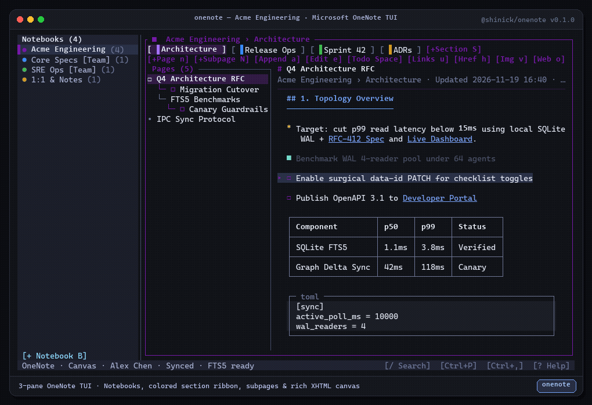

<div align="center">

# `@bitefoundry/onenote`

**Read and edit OneNote pages, search cached notebooks, and update checklists from the terminal.**

[](https://www.npmjs.com/package/@bitefoundry/onenote)
[](docs/NPM.md)
[](https://github.com/BiteFoundry/onenote/blob/master/Cargo.toml)
[](LICENSE)

[BiteFoundry](https://bitefoundry.dev/#app-onenote) · [Latest release notes](https://github.com/BiteFoundry/onenote/releases/latest)

<br />



</div>

---

## Highlights

| Capability | Details |
| --- | --- |
| **Minimal-Chrome 3-Pane TUI** | Personal and Teams/Group notebooks, colored section ribbon, nested subpages (`level 0/1/2`), bidirectional XHTML ↔ Markdown canvas, surgical `data-id` `PATCH` edits, optimistic to-do toggles, Link Extractor (`u`), File Picker with `zoxide` (`Ctrl+F`), and 6 themes. |
| **High-Res Terminal Images** | Inline thumbnails & fullscreen HD previews (`v` / `Alt+v`) with 80ms protocol probing for **Kitty**, **iTerm2**, **Sixel** (Floyd-Steinberg dithering), and **24-bit Unicode Half-Blocks** + `Ctrl+V` clipboard PNG upload. |
| **Local SQLite FTS5 + IPC Daemon** | WAL-mode SQLite cache with 4-reader pool, trigram full-text search (`/`), persistent `DraftStore`, and a shared background sync daemon (`onenote daemon start`). |
| **4-in-1 Agent Interface** | Interactive **TUI** (`onenote`), scriptable `--json` **CLI**, local **HTTP JSON API** (`onenote serve`, port `8793`), and stdio **MCP Server** (`onenote mcp`). |

---

## Quick Start

```sh
# 1. Install globally via npm (precompiled native binary for win32 / darwin / linux)
npm i -g @bitefoundry/onenote

# 2. Authenticate with Microsoft 365 (PKCE loopback, --device-code, or --token-file)
onenote login

# 3. Launch the interactive TUI
onenote
```

```sh
onenote read "Meeting notes" --json
```

Read a page with its key and notebook scope. Local search uses the identified account’s cache. If you use an opaque access token, run `onenote whoami` once online first. For full detail, add `--full` in the CLI or pass `compact: false` to `get_page` in MCP.

Build from source with `cargo build --release`. See [installation and migration](docs/NPM.md) for updating scripts, MCP configurations, and local HTTP clients.

### Company-managed Microsoft Entra sign-in

`onenote login` uses the public Microsoft Graph Command Line Tools client by default. To use a company-owned app, register it as a public client and configure the `http://localhost` redirect URI. Enable public client flows for headless `--device-code` sign-in. [Company app registration guide](https://github.com/BiteFoundry/teams/blob/master/docs/ENTERPRISE.md)

Add the Microsoft Graph delegated permissions your users need and have your Entra administrator grant consent where required.

| Feature | Delegated scopes |
| --- | --- |
| Profile and session refresh | `User.Read`, `offline_access` |
| Read, create, and edit the user's OneNote content | `Notes.Read`, `Notes.Create`, `Notes.ReadWrite` |
| Discover joined Teams and read or edit organizational notebooks the user can access | `Team.ReadBasic.All`, `Notes.Read.All`, `Notes.ReadWrite.All` |

The default sign-in adds the organizational scopes when you specify your company's tenant ID. Set `scopes` in `config.toml` to request a narrower set that matches your workflow.

```sh
onenote login --client-id YOUR_APP_ID --tenant-id YOUR_TENANT_ID
onenote whoami --json
```

For persistent environment configuration, set `ONENOTE_CLIENT_ID` and `ONENOTE_TENANT_ID`.

When supplying a token without an embedded user ID (for example an opaque `ONENOTE_ACCESS_TOKEN` or `ONENOTE_TOKEN_FILE`), run `onenote whoami` once while online to record only the token fingerprint and user ID under `identity-map/`. Running local `search` (without `--refresh`) or `--offline` with an unrecorded token returns an `Unknown identity` error instead of falling back to an empty `default` cache. Running `onenote search <query> --refresh` also records the identity binding. Whenever the token rotates or changes, run `onenote whoami` once again for the new token.

### Enterprise networks / custom CA

HTTPS connections trust the bundled Mozilla roots and the operating system's trust store. If your network inspects HTTPS with a private root CA that is not in either, export that root as PEM and point the CLI at it:

| Variable | Behaviour |
| --- | --- |
| `ONENOTE_EXTRA_CA_PEM` | PEM file (one certificate or a bundle) added to the trusted roots. If it cannot be read or parsed, the command fails with an error naming the file. |
| `SSL_CERT_FILE` | Also loaded as extra roots. An unusable file is reported on stderr and skipped. When set, it replaces the OS trust store for the native-roots lookup; the bundled roots still apply. |
| `NODE_EXTRA_CA_CERTS` | Also loaded as extra roots, so an existing Node.js setup works unchanged. An unusable file is reported on stderr and skipped. |

```sh
export ONENOTE_EXTRA_CA_PEM=/path/to/corporate-root.pem
onenote doctor --online
```

A certificate from an unknown issuer produces a `TLS certificate was not trusted (unknown issuer)` hint naming these variables. Certificate verification cannot be turned off. Warnings go to stderr only, so `onenote mcp` stdio output is unaffected.

---

## Keybindings Cheat Sheet

| Key | Action |
| --- | --- |
| `Tab` / `Shift+Tab` | Cycle focus (Notebooks → Pages → Note Canvas) |
| `j` / `k` · `↑` / `↓` | Navigate notebooks, pages, subpages, or blocks |
| `[` / `]` | Switch to previous / next section tab |
| `n` | Create a page (Markdown + `Ctrl+V` PNG) |
| `a` / `e` | Append Markdown block / surgically edit selected block |
| `Space` / `x` | Toggle selected To-Do checkbox (`data-tag="to-do:completed"`) |
| `B` / `S` / `D` | Create notebook / create section / delete page |
| `u` / `h` | Open Link Extractor modal / toggle inline `href` URLs |
| `v` / `o` / `y` | HD image preview / open in browser / copy page Markdown |
| `Ctrl+F` | Interactive File Picker (`z` for `zoxide` directory jump) |
| `/` | Instant full-text search across cached pages (SQLite FTS5) |
| `Ctrl+P` / `Ctrl+K` | Unified Command Palette & Omni-Switcher |
| `.` / Right-click | Context Menu |
| `Ctrl+,` / `Ctrl+B` / `?` | Settings / Toggle sidebar / Keyboard shortcuts help |

---

## CLI, HTTP API & MCP

### CLI

```sh
onenote notebooks --json
onenote pages "Acme Engineering/Architecture" --json
onenote rename-section 'me|SECTION_ID' --name 'Architecture Notes' --json
onenote rename-notebook --drive-id DRIVE_ID --item-id ITEM_ID --name 'Engineering Notes' --json
onenote read "Q4 Architecture RFC" --json
onenote read "Q4 Architecture RFC" --json --full
onenote copy-page 'me|PAGE_ID' --section 'me|SECTION_ID' --json
onenote create "Architecture" --title "Release Notes" '## Shipped
- [x] WAL pool' --json
onenote check "Migration Cutover" --block-id 'p:m3' --done --json
onenote search "canary" --json
```

`onenote read PAGE --json` returns compact Markdown and identifiers by default; pass `--full` for parsed blocks, raw XHTML, and resources. Passing an explicit `--format <fmt> --json` returns the full JSON page, and adding `--compact` selects the compact shape. Write commands (`append`, `update`, `check`) with `--json` return a compact summary (`ok`, `page_key`, `title`, `last_modified_at`, plus `block_id` / `completed` where applicable) by default; pass `--full` to include the full `page` object.

Page commands (`read`, `append`, `update`, `check`, `delete`) accept an optional `--section` (name, `Notebook/Section`, ID, or scoped key) to narrow title lookup to one section.

When a `--json` command fails at runtime, it exits 1 and writes a single JSON object (`{"ok":false,"error":{"code","message"}}`, plus top-level operation fields for non-completed `copy-page`) to stdout alongside the stderr error line. Successful read/list `--json` responses omit `ok` and signal success with exit 0; CLI argument/usage errors exit 2 on stderr without JSON.

`onenote notebooks --json` and `onenote sections --json` return 50 items by default (text output stays unbounded unless `--limit` is passed); `pages` defaults to 50 and `search` defaults to 30. All four JSON list responses include `returned`, `has_more`, and `next_cursor`, which can be passed back with `--limit` and `--cursor` to page through results. Full-text body search in `onenote search` covers pages that have been read or synced (`cache.pages_with_body`).

Use `onenote read PAGE --format blocks` to find a checkbox or text block's current element ID. Use `--done` or `--undone` to set a checkbox state. Omit both flags to toggle it.

`onenote notebooks` lists your personal notebooks, plus the notebooks of your joined Teams/Groups with `--include-teams`. SharePoint site notebooks are not auto-discovered; you can create one with `onenote create-notebook NAME --site SITE_ID`.

`copy-page` uses Microsoft Graph to create a new page in the destination section and preserves the original page and its links. If the copy is still pending, pass its `operation_url` with `--operation` to check the same copy. [Copy a page](docs/API.md#copy-a-page)

On Windows, `desktop-set-page-level` and `desktop-rename-section` work on existing objects in an open notebook. Use the OneNote app's **Move** command to move a page between sections. [Hierarchy operations and permissions](docs/API.md#hierarchy-operations)

### Local HTTP API (`onenote serve`)

```sh
# Start local Axum JSON server (default 127.0.0.1:8793) with your own API key
onenote serve --token dev-secret

# Query pages & FTS5 search from scripts or agents
curl -H "Authorization: Bearer dev-secret" \
  "http://127.0.0.1:8793/v1/onenote/search?q=canary&limit=10"
```

The API key is required on every route except `/health`. Without `--token` (alias of `--api-key`) or `ONENOTE_API_KEY`, a loopback server generates a random key and prints it once on stderr; pass `--allow-keyless` to run a loopback server without one. A non-loopback `--bind` always needs a key. Browser pages cannot call the API unless their exact origin is listed with `--cors-origin`, and requests whose `Host` is not a loopback name, the bind address or an `--allowed-host` are refused. [Authentication and access control](docs/API.md#authentication-and-access-control)

Full route reference & OpenAPI 3.1 spec: [docs/API.md](docs/API.md) · [docs/openapi.yaml](docs/openapi.yaml).

### Model Context Protocol (`onenote mcp`)

Add to Claude Desktop, Claude Code, Cursor, or Codex over stdio JSON-RPC 2.0.

```json
{
  "mcpServers": {
    "onenote": {
      "command": "onenote",
      "args": ["mcp"]
    }
  }
}
```

Full tool catalog & schemas: [docs/MCP.md](docs/MCP.md).

---

## `@bitefoundry` Enterprise Terminal Suite

| Package | Commands | Workspace Coverage |
| --- | --- | --- |
| [`@bitefoundry/teams`](https://www.npmjs.com/package/@bitefoundry/teams) | `teams` | Microsoft Teams chats, channels, threads & meetings |
| [`@bitefoundry/outlook`](https://www.npmjs.com/package/@bitefoundry/outlook) | `outlook` | Microsoft Outlook mail, calendar & contacts |
| **`@bitefoundry/onenote`** | `onenote` | Microsoft OneNote notebooks, sections, pages & XHTML/Markdown |
| [`@bitefoundry/sharepoint`](https://www.npmjs.com/package/@bitefoundry/sharepoint) | `sharepoint`, `bitefoundry-onedrive` | Microsoft SharePoint sites, document libraries & OneDrive files |
| [`@bitefoundry/atlassian`](https://www.npmjs.com/package/@bitefoundry/atlassian) | `atlassian`, `confluence`, `conf` | Atlassian Jira issues, boards, sprints & Confluence pages |
| [`@bitefoundry/notion`](https://www.npmjs.com/package/@bitefoundry/notion) | `notion` | Notion pages, databases, blocks & Markdown sync |

---

## License & Disclaimer

Licensed under the **MIT License**.

> Unofficial terminal client for Microsoft OneNote. Not affiliated with, endorsed by, or sponsored by Microsoft Corporation.
